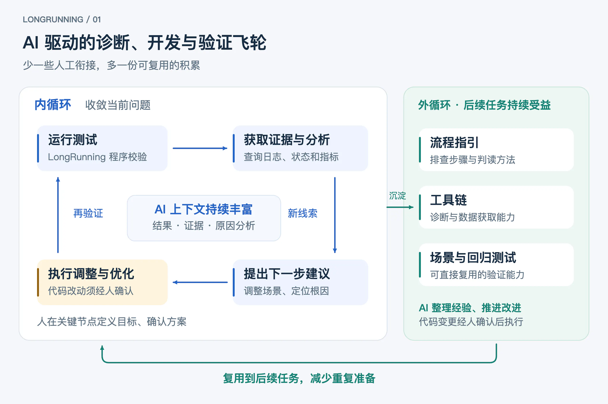
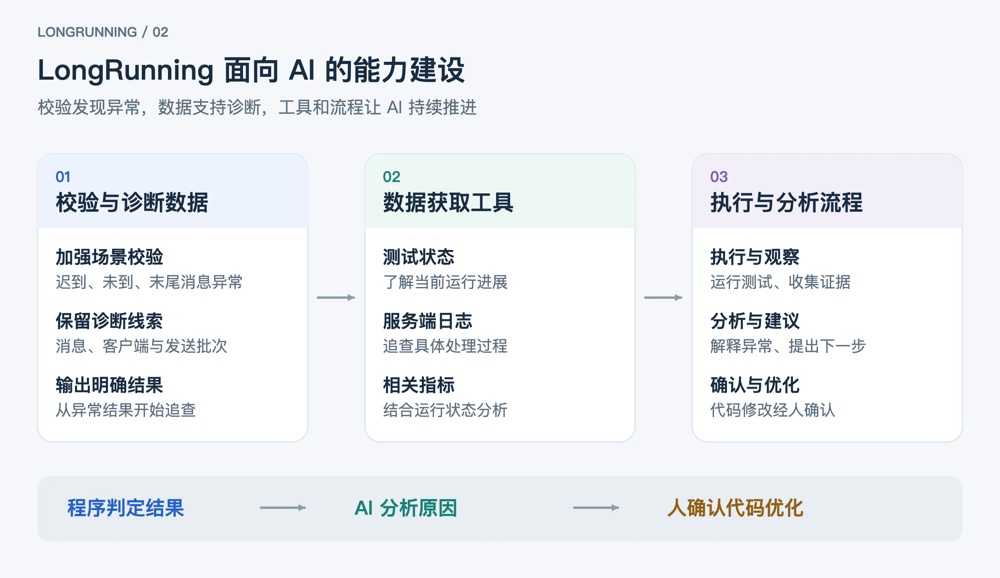
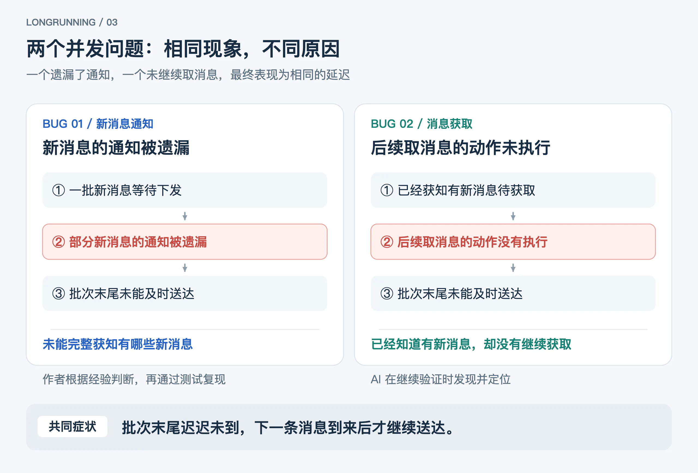
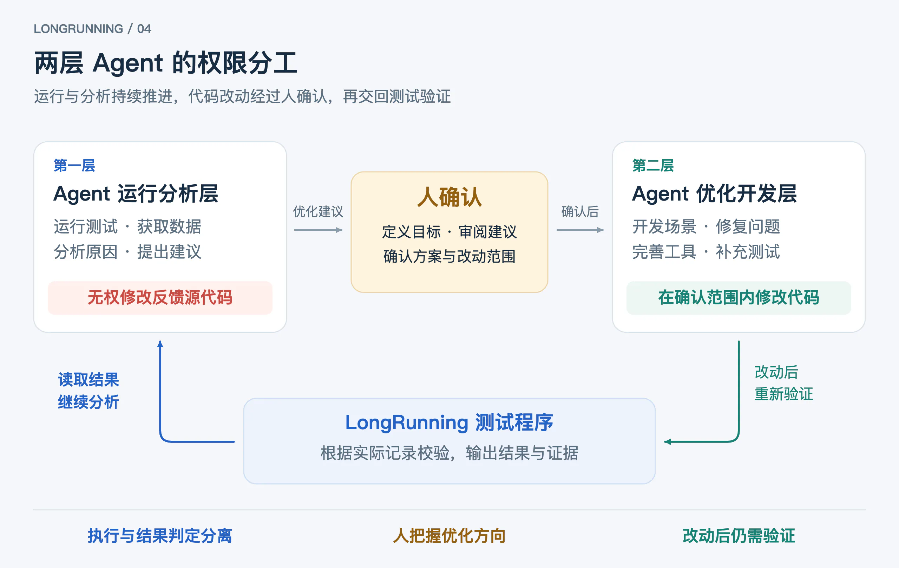

复现一个复杂的并发问题，过去从搭建测试环境、调试场景到完成验证，往往至少需要一周。这次，在已有的 LongRunning 测试项目中引入 AI 后，一天之内就完成了场景构造、问题复现和修复验证，其间还发现了另一个并发问题，继续完成了定位、修复和再验证。

<!--more-->

## 从至少一周，到一天内完成复现与验证

在引入 AI 之前，LongRunning 就已经具备消息校验和长期压力测试能力。它在真实环境中模拟大量客户端收发消息，逐条检查消息是否送达、是否重复、内容是否正确，可以用于复现故障、验证修复和持续检验系统稳定性。

不过，将这些能力用于一个具体问题，仍然需要投入不少精力。使用者要先熟悉项目、配置环境，再根据问题设计和调试场景。测试开始后，还要跟踪运行、从多个系统收集信息、分析结果，并决定下一步。一次没有复现，就需要调整条件重新尝试；修复后出现新的异常，还要继续调查。每个环节都依赖人工衔接，复杂场景尤其如此。

为此，作者将 LongRunning 的测试、诊断与优化流程构建成一个 AI 驱动的飞轮。AI 持续执行测试、收集证据并分析结果，减少了各环节之间的人工衔接，让研发人员从反复操作和信息整理中释放出来，将时间投入问题定义和关键决策。

这个飞轮还能够在运行中不断完善自身。内循环把每轮测试和分析得到的证据自动补充到 AI 的上下文中，据此调整下一步行动，逐步收敛问题并推进优化；外循环则将可复用的经验自动沉淀为流程指引、工具链改进和新的测试场景，让后续任务直接受益。

## LongRunning 的 AI 改造

### 增强校验，提供可追查的数据

AI 分析测试结果，需要知道具体发生了什么。仅观察整体吞吐量和平均延迟，容易忽略少量消息的投递异常。对于成批发送的消息，校验还需要区分整批未到、晚于规定时间到达，以及前面的消息都正常、只有最后一条始终未到等情况。

因此，改造从具体场景的测试任务开始。一方面加强校验，让这些异常能够被明确发现；另一方面丰富输出数据，使异常可以与具体消息、客户端和发送批次联系起来。

这些信息为后续调查提供了起点。AI 可以进一步分析未送达的消息是否集中在批次末尾，是否只发生在部分客户端，以及异常出现时测试处于什么阶段。校验负责确认投递结果，诊断数据则帮助缩小调查范围。

### 提供获取数据的工具

测试侧发现异常后，还需要了解服务端发生了什么。过去，这一步通常要由人查询日志、查找指标，再把信息整理出来。

为此，LongRunning 的配套工具向 AI 提供了获取测试状态、服务端日志和相关指标的能力。AI 可以从异常消息出发，查询对应客户端的处理记录，将测试侧看到的投递结果与服务端的处理过程联系起来。

数据获取也由此成为分析过程的一部分。发现新的线索后，AI 能够继续查询相关记录，检验原因判断，再提出下一步调查或优化建议。

### 将这些能力串联成流程

在校验、数据和工具的基础上，作者进一步整理了场景准备、测试执行、运行观察、证据归档和结果分析的流程。AI 能够按流程完成一次测试，并利用得到的信息规划后续工作：没有触发问题时，分析场景需要怎样调整；出现异常时，继续收集证据、定位原因。

运行与分析阶段不修改代码。涉及新场景开发或问题修复的建议，需要经过研发人员确认，再进入开发环节。这样，AI 可以持续推进已确认的测试和调查，代码优化则保留明确的决策节点。

## 案例：消息延迟问题的复现与修复

### 从现象确定场景

这次实践源于一次用户反馈：消息偶尔会延迟很久才送达，最长的一次约 23 分钟。作者根据经验找到了一个可能的并发原因，并完成初步修复，但线上缺少能够直接证明原因的日志，还需要通过复现和测试验证。

这个现象有一个重要特征：消息已经写入，却要等后续消息到来才一并送达。如果测试始终匀速发送，后续消息可能很快触发投递，使异常不容易显现。

因此，需要构造更接近问题现象的流量：客户端在短时间内连续发送一批消息，随后停止一段时间，观察这一批是否全部按时送达。多个客户端的发送高峰还需要能够叠加或错开，以覆盖不同的并发条件。

作者同时明确了验证目标：旧版本能够重复暴露问题，修复版能够在持续测试中保持稳定。这样，测试既要检验修复效果，也要证明所用场景确实有能力发现原来的问题。

AI 阅读修复代码和既往排查记录后，提出了针对性的场景方案。方案确认后，AI 用约一小时完成了开发：支持周期性的成批发送，调整多个客户端的并发方式，并对迟到、整批未到和批次末尾未到分别进行校验。

### 测试结果推动下一步调查

首轮测试将不同客户端的流量错开，没有复现问题。结合运行结果和代码分析，AI 判断需要制造更集中的并发压力，于是调整发送方式，让大量客户端在同一时刻发送。

调整后，旧版本能够稳定复现异常。诊断数据进一步显示，未及时送达的消息集中在每一批的末尾，与最初观察到的现象一致。

这些结果为第一个问题提供了测试依据：部分新消息的通知被遗漏，导致批次末尾的消息没有及时下发。场景能够复现异常后，接下来便可以检验修复效果。

然而，仅修复第一个问题的版本在持续测试中仍然出现了末尾消息未按时送达的情况。这说明，还有其他原因需要调查。

AI 通过工具获取服务端日志，比对受影响客户端的处理记录，定位到了另一个并发问题：服务端已经获知有新消息，却没有继续获取，导致这一批的末尾消息未能送达。这个问题不在最初修复的范围内，是持续测试暴露异常后，AI 沿着实际证据进一步调查得到的发现。

### 确认方案，再修复和验证

定位原因后，AI 提出了修复建议。作者确认方案，并要求先用测试稳定复现，再修改代码。

进入开发环节后，AI 编写了确定性的单元测试，通过控制相关操作的先后顺序，重现触发问题的并发条件。测试在修复前失败，在修复后通过，使后续验证不必只依赖长时间运行中偶然出现的异常。

完成两处修复的版本随后在真实环境中通过了两次各 60 分钟的测试，累计约 2346 万条消息，无消息丢失，也没有再出现此前的消息停滞现象。旧版本的对照测试仍能复现异常。AI 沿用此前沉淀到流程指引中的判读方法分析日志，确认这些异常来自第一个问题。这次调查中整理出的经验，已经用于后续验证。

至此，最初根据经验提出的原因判断得到了复现依据，持续测试中发现的第二个问题也完成了定位、修复和验证。新场景既能暴露旧版本的问题，也能用于后续修复的回归验证。

## 变化不止是完成得更快

在这一天里，耗时最长的环节已经是测试运行本身。测试持续进行时，研发人员可以投入其他工作；结果产生后，AI 继续收集证据、分析异常，并准备下一步建议。人的注意力不再被每一轮执行和信息整理持续占用。

研发效率提升 10 倍的背后，是这种工作方式的变化。研发人员把精力集中到定义问题、审阅证据和确认优化方向，AI 则把具体工作连续推进到下一个需要人作出选择的节点。从复现原来的问题，到进一步发现并修复另一个问题，探索可以随着测试反馈不断深入。

案例中的内循环，体现在每次反馈都进入了后续分析：首轮未复现促使 AI 调整并发方式，后续验证中的异常又引出了新的调查。随着测试结果、日志和原因分析不断丰富上下文，AI 能够逐步缩小问题范围，提出更具体的实验和修复建议。

外循环则把这次探索中的有效方法留下来。判读经验写入流程指引，诊断和数据获取能力补充到工具链，新场景与回归测试保留在项目中。AI 负责整理这些经验并推进改进，涉及代码的变更经研发人员确认后执行。下一次处理类似问题时，AI 可以直接利用这些积累，减少重新熟悉流程、构造场景和摸索诊断方法的成本。飞轮的收益也由此从当前任务延伸到了后续任务。

## 让持续探索有据可依

减少人工投入的同时，测试结论仍有明确依据。消息是否按要求送达，由测试程序根据实际记录校验。案例中，第一次修复后测试仍然发现异常，AI 因此继续调查，最终找到了另一个问题。

这种反馈的确定性，来自明确的校验标准：对于相同且充分的证据，程序给出一致的判定；证据不足时，不能直接视为成功。偶发问题未必每次都能复现，但一旦出现受校验覆盖的异常，AI 就有了需要解释和处理的事实。

无论是解决当前问题，还是完善供后续任务使用的工具和场景，都遵循同一套权限分工。Agent 的运行分析层负责测试、数据分析和后续建议，没有修改反馈源代码的权限；优化开发层在研发人员确认和指导下修改代码，完成后再交回测试验证。

LongRunning 的这次改造，也提供了一种构建 Agent Harness 的思路：先找到可重复运行、判定明确的反馈源，再围绕它补齐数据、工具和执行流程。模型依据反馈推进探索，研发人员在关键节点确认方向，经过验证的经验继续用于下一次任务。
